# Lamination Cutter — User Manual

A complete reference for the Lamination Cutter. For a short overview, see the [README](../README.md).

---

## Contents

1. [What it makes](#1-what-it-makes)
2. [Workflow](#2-workflow)
3. [Panel reference](#3-panel-reference)
4. [The five views](#4-the-five-views)
5. [Reading the numbers](#5-reading-the-numbers)
6. [Width classes and the trapezoid](#6-width-classes-and-the-trapezoid)
7. [Pole shoes](#7-pole-shoes)
8. [Cutting practice](#8-cutting-practice)
9. [The retention frame](#9-the-retention-frame)
10. [Output files](#10-output-files)
11. [Warnings](#11-warnings)
12. [Limitations](#12-limitations)
13. [Wire EDM](#13-wire-edm)

---

## 1. What it makes

The tool cuts the teeth of a **yokeless, segmented-armature (YASA) axial-flux stator**. Each tooth sits between two rotors and carries flux straight along the machine axis.

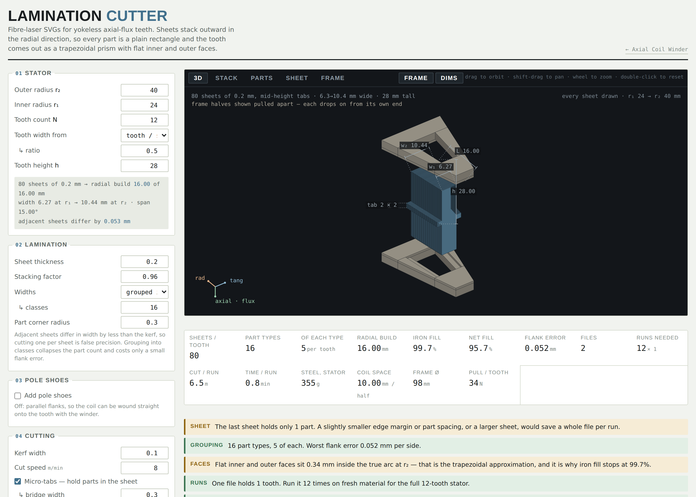

### Radial stacking

The sheets are stacked **radially**: the first sheet sits at the inner radius r₁, and each further sheet sits one thickness further out, up to r₂. Every sheet lies in the tangential–axial plane, so:

- the flux path (axial) lies in the sheet, as it must;
- slot-leakage flux, which runs tangentially from tooth to tooth, also lies in the sheet rather than crossing it;
- every sheet is a **plain rectangle**, `w(r) × h`, where `w(r)` is the tooth width at that sheet's radius and `h` is the tooth height.

The finished tooth is a trapezoidal prism. Its flanks are a fine staircase of sheet edges, and its inner and outer faces are flat.

### Coordinates

| Symbol | Meaning |
|---|---|
| r₁, r₂ | Inner and outer radius of the tooth |
| N | Number of teeth |
| w₁, w₂ | Tooth width at r₁ and at r₂ |
| L | Radial length, `r₂ − r₁` |
| h | Tooth height along the axis, the flux direction |
| t | Sheet thickness |
| α | Half the angular span of the tooth |

In the parts and the SVG, **sheet X is the tangential width and sheet Y is the tooth height**. Y should lie along the steel's rolling direction (see [§8](#rolling-direction)).

---

## 2. Workflow

1. **Define the stator** in panel 01, using the same numbers you give the winder.
2. **Pick the sheet** in panel 02 and leave the width classes at 16 unless you have a reason to change them.
3. **Decide on pole shoes** in panel 03. They are off by default.
4. **Choose the process** in panel 04. For the fibre laser, set the kerf, speed, engraving and micro-tabs. For wire EDM, the teeth are cut from a stacked block instead (see [§13](#13-wire-edm)).
5. **Check the nest** in panel 05 and the Sheet view. One tooth per file is the default.
6. **Optionally add the retention frame** in panel 06 if the teeth will be held by a printed frame.
7. **Download** the SVG and the parts list, and the frame zip if you use one.
8. **Cut the file N times**, once per tooth, on fresh material each time.
9. **Stack each tooth** in index order: class 0 at the inner radius, rising outward.
10. **Hold the stack** by bonding it or with the frame, then wind it with the [Axial Coil Winder](../../README.md).

---

## 3. Panel reference

### 01 — Stator

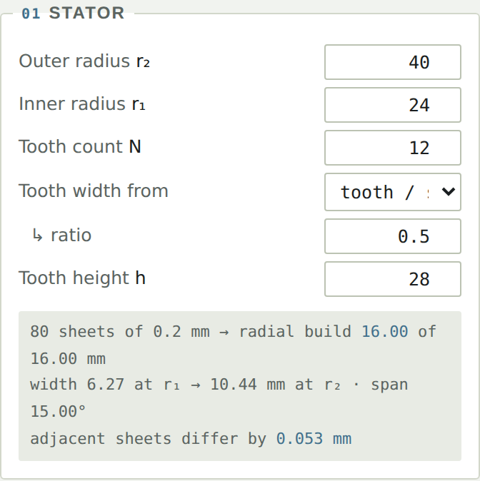

| Field | Default | Meaning |
|---|---|---|
| **Outer radius r₂** | 40 mm | Outer end of the tooth |
| **Inner radius r₁** | 24 mm | Inner end of the tooth |
| **Tooth count N** | 12 | Teeth around the stator |
| **Tooth width from** | tooth / slot pitch | How the width is defined (below) |
| ↳ **ratio** | 0.5 | Tooth span as a fraction of the slot pitch |
| ↳ **span** | 15° | Full angular span of the tooth (angle mode) |
| ↳ **width at r₁ / r₂** | 6.27 / 10.44 mm | Explicit widths (measured mode) |
| **Tooth height h** | 28 mm | Axial length of the tooth, pole shoes included |

**Width modes:**

- **tooth / slot pitch** and **tooth angle** both give radial flanks, `w(r) = 2·r·sin α`. The span is capped at 98% of the pitch so neighbouring teeth can never touch.
- **measured widths** takes w₁ and w₂ directly and interpolates linearly between them. Use it for teeth whose flanks are not radial, for example parallel-sided teeth.

The derived block underneath gives the sheet count and radial build, the widths at r₁ and r₂, the angular span, and the width step between adjacent sheets.

### 02 — Lamination

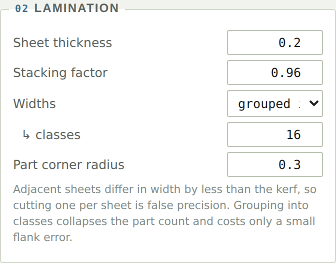

| Field | Default | Meaning |
|---|---|---|
| **Sheet thickness** | 0.2 mm | Nominal thickness, coating included. Minimum 0.1 mm |
| **Stacking factor** | 0.96 | Fraction of the stack that is steel. Used only for the *Net fill* figure |
| **Widths** | grouped into classes | Or *one per sheet (exact)* |
| ↳ **classes** | 16 | Number of distinct widths per tooth |
| **Part corner radius** | 0.3 mm | Fillet on every corner of every part, convex and concave |

The number of sheets per tooth is `floor((r₂ − r₁) / t)`. Any remainder under one sheet is left as a gap at the outer face, and a note tells you how big it is.

### 03 — Pole shoes

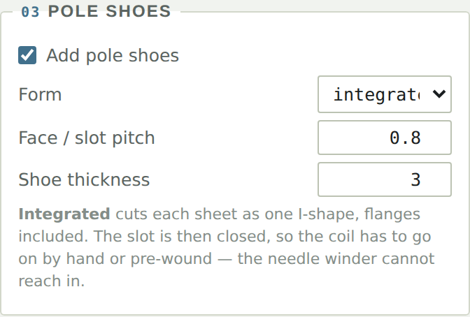

| Field | Default | Meaning |
|---|---|---|
| **Add pole shoes** | off | Widen the tooth at both ends to form a pole face |
| **Form** | integrated | *integrated*: each sheet is one I-shaped part. *separate*: end plates are cut on their own |
| **Face / slot pitch** | 0.8 | Pole-face span as a fraction of the slot pitch. Never narrower than the tooth itself |
| **Shoe thickness** | 3 mm | Axial thickness of each flange or plate. Capped so the body keeps at least 0.5 mm |

See [§7](#7-pole-shoes) for which form to choose.

### 04 — Process

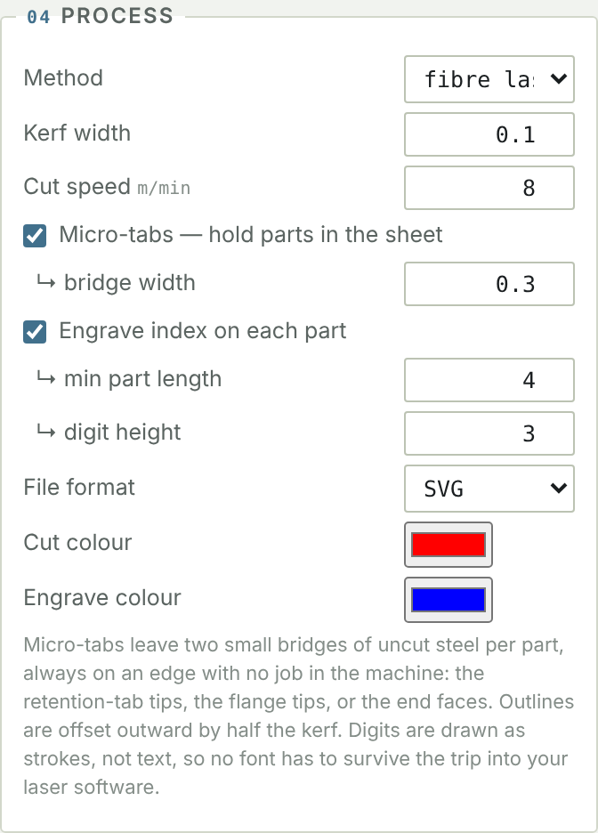

**Method** is either *fibre laser, sheet by sheet* (the default) or *wire EDM, stacked block*. The fields below are for the laser. Choosing EDM swaps them for the EDM fields described in [§13](#13-wire-edm), and hides panel 05.

| Field | Default | Meaning |
|---|---|---|
| **Kerf width** | 0.1 mm | Measured beam width. Every outline is offset outward by half of it |
| **Cut speed** | 8 m/min | Used only for the time estimate |
| **Micro-tabs** | on | Leave two bridges of uncut steel on each part (see [§8](#micro-tabs)) |
| ↳ **bridge width** | 0.3 mm | Width of steel left in each bridge |
| **Engrave index on each part** | on | Stroke the class number onto each part |
| ↳ **min part length** | 4 mm | Parts narrower than this are not engraved |
| ↳ **digit height** | 3 mm | Height of the seven-segment digits |
| **Cut / Engrave colour** | red / blue | Stroke colours, for mapping to laser layers (SVG) |

### 05 — Sheet

Laser only.

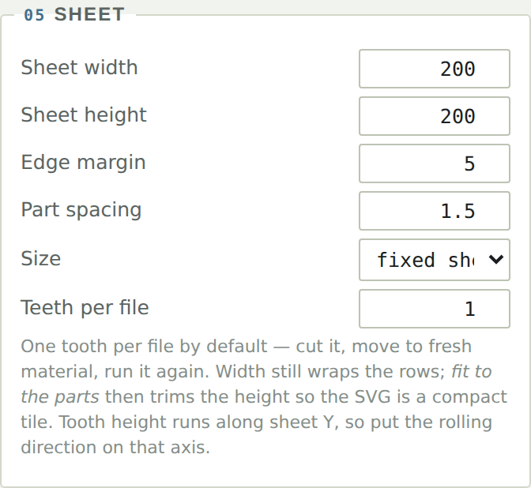

| Field | Default | Meaning |
|---|---|---|
| **Sheet width / height** | 200 / 200 mm | Material size. In *fit* mode only the width is used, to wrap the rows |
| **Edge margin** | 5 mm | Clear border round the nest |
| **Part spacing** | 1.5 mm | Gap between parts |
| **Size** | fixed sheet | *fit* trims the SVG to the parts. *fixed* nests onto full sheets and starts a new file when one is full |
| **Teeth per file** | 1 | How many teeth' worth of parts go into each file |

Nesting places parts in rows of constant height, one part type after another, and never rotates them, so the tooth height always stays on sheet Y.

### 06 — Retention frame

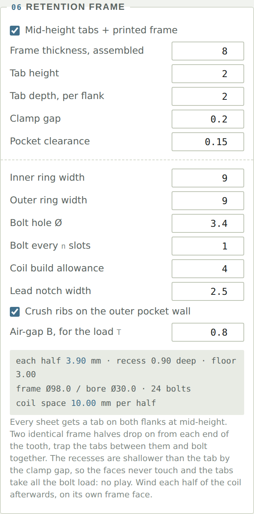

On by default. Every body sheet gets a tab on both flanks at mid-height, and a printed frame is generated to hold them. Every field is explained in [§9](#9-the-retention-frame).

---

## 4. The five views

Every view zooms. Use the mouse wheel or a two-finger pinch, drag to pan, and double-click to reset. In 3D, dragging orbits and shift-drag pans. Zoom centres on the cursor, so you can point at a corner and wheel in.

Parts and Sheet are drawn from the same path that is written to the SVG. Corner radii, tab fillets and micro-tab gaps therefore show at their true size once you zoom in, and each micro-tab is circled.

### 3D

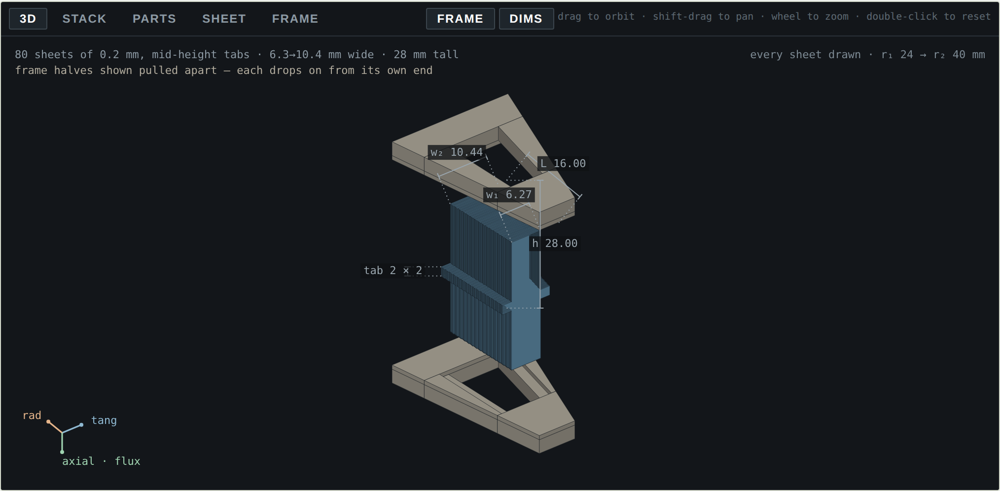

The tooth, with every sheet drawn when there are 240 or fewer; above that, each width class is drawn as one block.

- **Controls:** drag to orbit, shift-drag to pan, wheel to zoom.
- **Dims** toggles the main dimensions: w₁, w₂, L and h, plus the pole face and shoe thickness when shoes are on.
- With the retention frame on, a **Frame** toggle shows both halves pulled apart along the axis, each on the side it slides on from.

| Integrated shoes | Separate shoe plates | Frame, exploded |
|---|---|---|
| 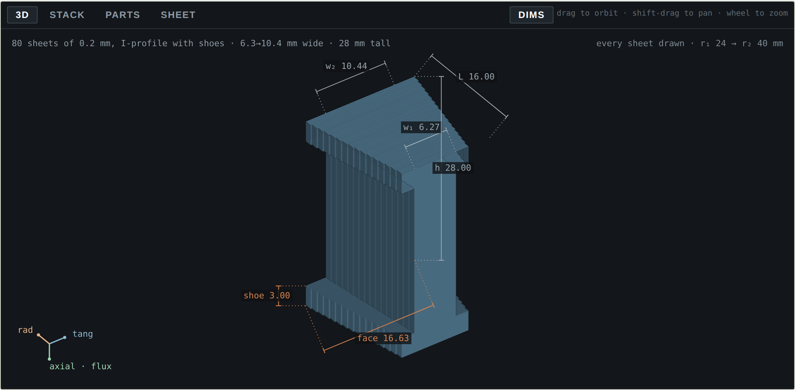 | 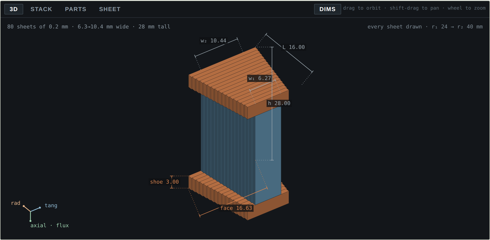 |  |

### Stack

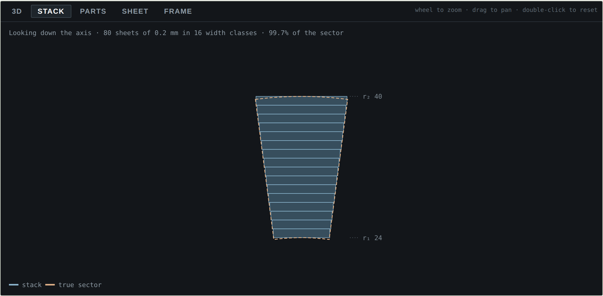

Looking down the machine axis. Each width class is drawn as a band, and the true sector it approximates is drawn dashed. The gap between them is the trapezoidal approximation: the staircase on the flanks, and the chord at each face.

### Parts

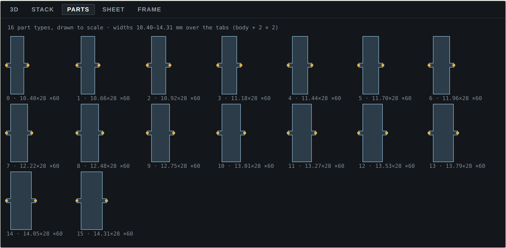

Every part type, drawn to the same scale and labelled with its index, width × height and total quantity for the stator. With micro-tabs on, each bridge is marked with an amber dot.

| Integrated shoes | Separate shoes | Retention tabs | Micro-tabs |
|---|---|---|---|
| 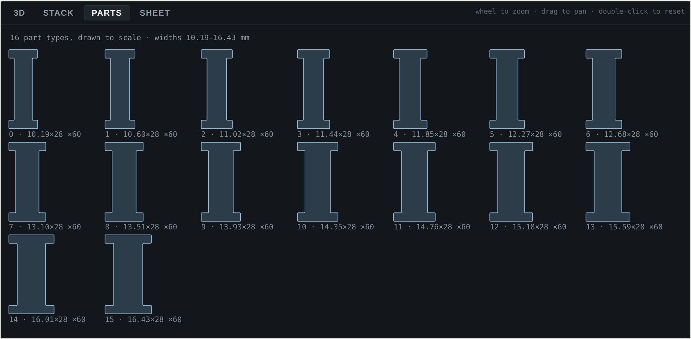 | 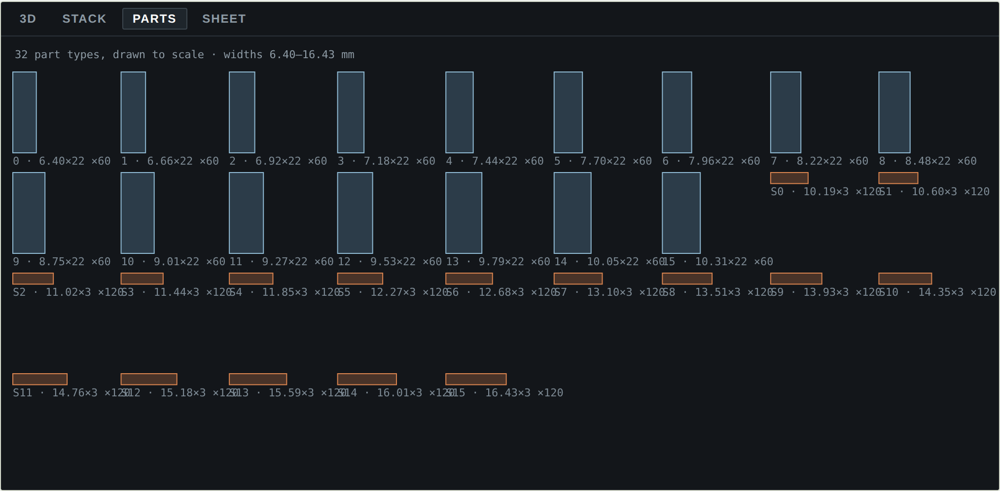 | 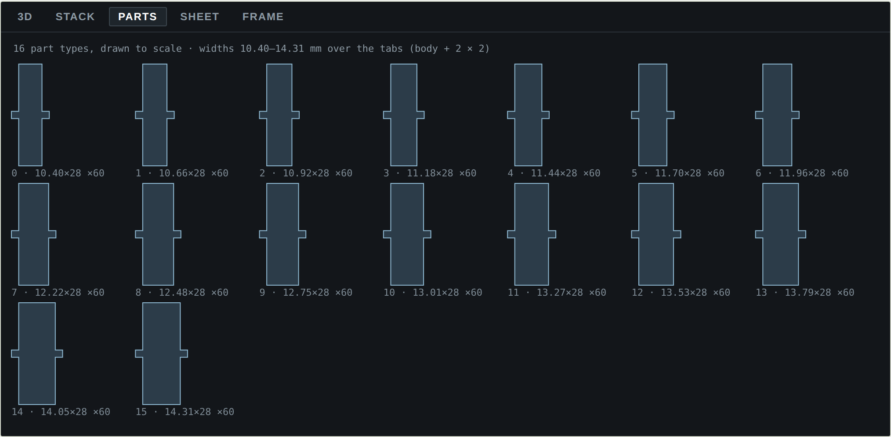 | 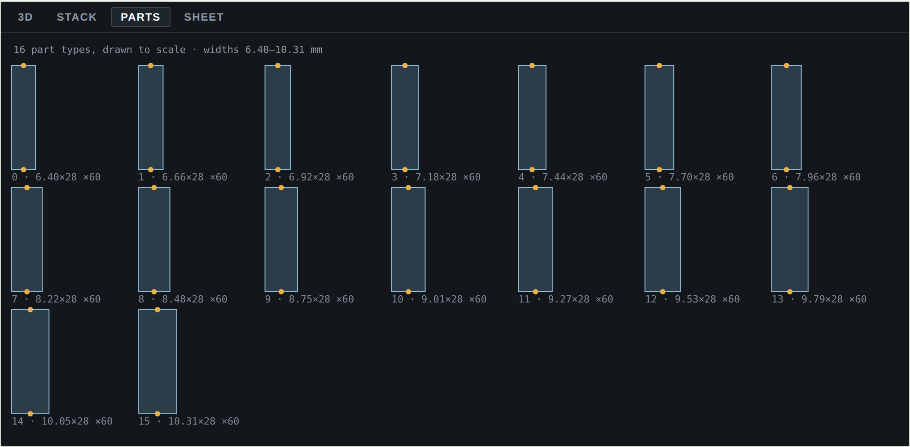 |

### Sheet

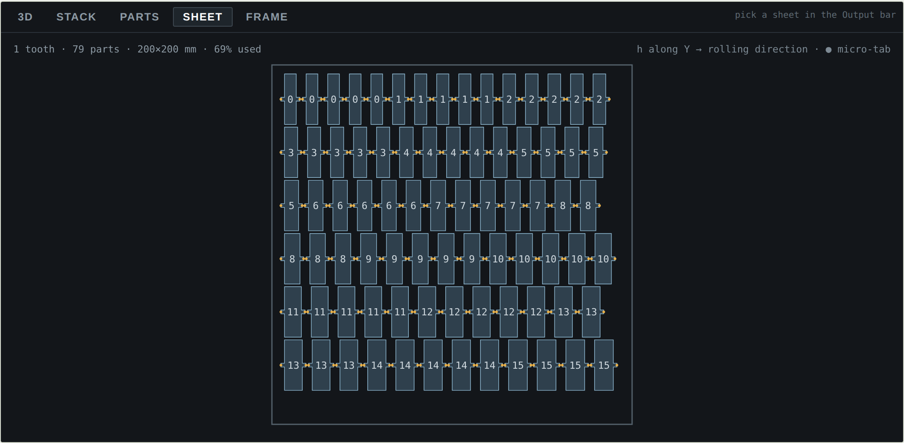

The nest exactly as it will be cut, for the file chosen in the Output bar. The header gives the part count, the sheet size and the material used.

### Frame

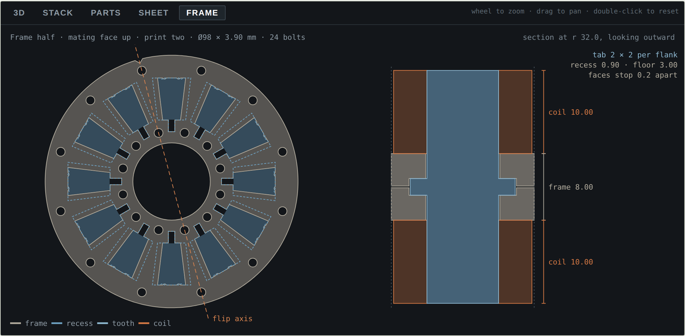

Only with the retention frame on.

- **Left:** one frame half seen from its mating face. The teeth are drawn in their pockets, the tab recesses dashed, and the flip axis through the index notch.
- **Right:** a section through one tooth at the mean radius, looking outward. It shows the tooth with its tabs, both frame halves, the clamp gap, and the space left for the coil on each side.

---

## 5. Reading the numbers

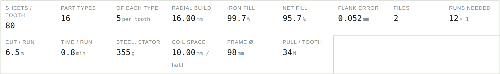

| Readout | Meaning |
|---|---|
| **Sheets / tooth** | Total parts per tooth, shoe plates included |
| **Part types** | Distinct parts to cut |
| **Of each type** | Average quantity of each type per tooth |
| **Radial build** | Sheets × thickness. Can be up to one sheet short of L |
| **Iron fill** | Stacked body area over the ideal area: the true sector in ratio and angle modes, the trapezoid in measured mode |
| **Net fill** | Iron fill × stacking factor, the fraction that is actually steel |
| **Flank error** | Worst deviation of a class width from the ideal flank, per side |
| **Files** | SVG files produced |
| **Runs needed** | Times to run the file for the whole stator, × teeth per file |
| **Cut / run** | Total cut length in one file |
| **Time / run** | Cut length ÷ cut speed. Ignores travel, acceleration and repeat passes |
| **Steel, stator** | Mass of every part for all N teeth, at 7650 kg/m³ |

With the retention frame on, three more appear: **coil space** per half, **frame Ø**, and the **pull per tooth** at the air-gap flux density you entered.

---

## 6. Width classes and the trapezoid

### The step between sheets

With radial flanks, `w(r) = 2·r·sin α`, so adjacent sheets differ by

```
Δw = 2 · t · sin α
```

That is 0.052 mm for a 15° tooth in 0.2 mm sheet, less than a typical fibre-laser kerf. Cutting 80 different widths therefore adds part types without adding accuracy.

### Grouping

The sheets are split into G runs of nearly equal length. Each run is cut at the width for its **mid radius**, so the iron area stays the same and the flank error is shared evenly either side:

```
flank error per side ≈ (w_last − w_first) / 4
```

where `w_first` and `w_last` are the ideal widths of the first and last sheet in the class. On the default stator:

| Classes | Flank error per side | Per tooth, of each |
|---|---|---|
| 80 (exact) | 0 between sheets, about 0.01 within one sheet | 1 |
| **16** | **0.052 mm** | 5 |
| 8 | 0.117 mm | 10 |
| 4 | 0.248 mm | 20 |

As a guide, keep the flank error below the slot liner thickness, or below one sheet thickness if the coil is wound straight onto the steel. The tool warns above two sheet thicknesses.

### Flat faces

Each sheet is flat and perpendicular to the radius, so the inner and outer faces are chords. The shortfall at the centre of the outer face is the sagitta:

```
s = r₂ · (1 − cos α)
```

That is 0.34 mm at r₂ = 40 mm with a 15° tooth. It, rather than the flank staircase, is what holds iron fill at 99.7%. It also means the outer face sits up to 0.34 mm inside the rotor magnets' outer radius, which is usually harmless.

---

## 7. Pole shoes

Shoes widen the tooth at both ends to spread flux over more magnet. They are off by default because they decide how the coil goes on.

| | Integrated | Separate |
|---|---|---|
| Parts | One I-shape per sheet, flanges included | Shortened body sheets, plus end plates (prefix **S**), two per class |
| Slot | Closed by the flanges | Open until the plates go on |
| Coil | Wound by hand, or pre-wound on a bobbin with the stack built up inside it | Needle-wound onto the body first, then the plates bonded on |
| Retention frame | Not possible: neither half can pass a flange | Works. Bond the plates after winding |

The pole-face width is `2·r·sin α_shoe`, where `α_shoe` comes from *Face / slot pitch* and is never narrower than the tooth itself.

---

## 8. Cutting practice

### Kerf

Measure it rather than guessing: cut a 10 × 10 mm square with the kerf set to zero, measure it, and the shortfall is the kerf. Every outline is then offset outward by half the kerf, so the part comes out at nominal size.

### Corner radius

Every corner, convex and concave, gets the *Part corner radius* (0.3 mm by default, about one sheet thickness).

- At a sharp corner the beam has to stop and turn while the laser power stays the same. The corner overburns and the kerf widens there.
- A radius keeps the speed steady, which gives a cleaner edge, less dross and a smaller heat-affected zone. That matters for the magnetic properties at the edge.
- On a galvo fibre engraver cutting in many passes, overburn builds up with every pass, so the radius helps even more.

Two limits apply when the retention frame is on:

- **Tab root (concave corner):** keep the radius at or below about twice the pocket clearance, or the fillet bites into the printed recess edge. 0.3 mm leaves about 0.04 mm of overlap, which is harmless.
- **Tab bearing face:** a tab loses one radius at its tip and one at its root, so a 0.3 mm radius leaves 1.4 mm of flat face on the default 2 mm tab. On a shallow tab this matters: a 1 mm tab keeps only 0.4 mm, which roughly doubles the bearing stress on the plastic.

The laser radius does **not** round the corners the wire wraps round. In plan view those are the edges of the first and last sheet, and they stay square with a burr. Use a slot liner, or break those edges by hand, before winding.

### Micro-tabs

With micro-tabs on, each part keeps two bridges of uncut steel so it stays in the sheet between passes and does not drop through the bed. The cut path has a gap of *bridge width + kerf*, so the steel left behind is exactly the bridge width.

Bridges always go on an edge that has no job in the finished machine:

| Part | Bridges on | Why |
|---|---|---|
| Body with retention tabs | The tip of each tab | Nothing bears on the tip, and the stub sits in the 0.15 mm recess clearance |
| Plain body | Middle of both end faces | The stubs line up across the stack, so one file stroke dresses every stub at once |
| Integrated I-shape | Two diagonally opposite flange tips | The slot-opening sides |
| Shoe plate | Both short ends | The slot-opening sides |

They never go on a flank, which is both the coil face and the frame-pocket fit. With separate shoe plates, dress the body's end-face stubs flat before bonding the plates on. A note warns if a part type is too small to take both bridges.


### Pierce point

Each outline starts, and is pierced, at a corner, or just after a bridge when micro-tabs are on. A pierce can leave a small nick or bump. If your laser software lets you move the start point, put it on a flank away from the tab.

### Rolling direction

Non-oriented electrical steel is still slightly anisotropic, with lower loss along the rolling direction. Flux runs along the tooth height, which is sheet **Y** in every file, so put the rolling direction on Y when you load the material. Parts are never rotated in the nest, so this holds for every part.

### Engraving

Each part carries its class index (`0`, `1`, … for bodies, `S0`, `S1`, … for shoe plates), drawn as stroked seven-segment digits in the engrave colour. Map that colour to a light marking pass, not a cut. The digits are paths, not text, so no font has to exist on the laser PC.

### Running the file

The default is **one tooth per file**: cut it, slide on fresh material, run the same file again, N times in all. Sort each run's parts by index into one pile per tooth.

---

## 9. The retention frame

### Why

The rotors pull every tooth along the axis. At an air-gap flux density B, the magnetic pressure on the tooth face is `B²/2μ₀`:

- at 0.8 T that is about 0.25 MPa, or **34 N** on the default tooth;
- across the stator that is **0.41 kN**, and it comes from one side only while the first rotor goes on.

The pull also gets stronger as a tooth moves toward the rotor, so any play makes things worse rather than settling. In a yokeless stator nothing else holds the teeth. For a first prototype, a 3D-printed frame at mid-height does the job.

### The design


- **A tab, not a groove.** Every body sheet gets a tab on both flanks at mid-height. A groove would take steel out of the narrowest part of the tooth, where flux density is already highest. A tab only adds steel, and only in the slot.
- **Rectangular on purpose.** The recess that matches the tab profile is built up by the printer in layers, and at under a millimetre deep only a rectangle prints true. Flat bearing faces perpendicular to the pull also keep the plastic in plain compression. A sloped tab would wedge the pocket open.
- **Two identical halves.** The frame splits at the axial mid-plane. One half slides on from +z, the other from −z, and together they trap the tabs. The bolt pattern is symmetric about the index notch, so one file is printed twice and one copy turned over.
- **No play, by construction.** The two recess depths add up to less than the tab height by the clamp gap, so the frame faces stop short of each other and tightening the bolts loads the tabs, not the faces.
- **A stacking jig too.** The loose sheets are held in their pockets before any copper or adhesive goes on.

Each tab carries about 0.2 N (34 N over 80 sheets and two flanks), so the steel is nowhere near its limit. Every sheet does need its own tab, because the sheets are not bonded and each is held on its own.

### Panel 06 fields

| Field | Default | Meaning |
|---|---|---|
| **Frame thickness, assembled** | 8 mm | Both halves plus the clamp gap. Enter the same value in the winder |
| **Tab height** | 2 mm | Axial height of the tab, centred on the tooth |
| **Tab depth, per flank** | 2 mm | How far the tab stands out from each flank |
| **Clamp gap** | 0.2 mm | How far apart the frame faces stop. Each recess is `(tab − gap)/2` deep |
| **Pocket clearance** | 0.15 mm | Per side, between the tooth and the printed pocket |
| **Inner ring width** | 9 mm | Plastic inside r₁. Bolts sit at mid-ring |
| **Outer ring width** | 9 mm | Plastic outside r₂ |
| **Bolt hole Ø** | 3.4 mm | Through hole for a bolt and nut. 3.4 mm suits M3. 0 means no bolts |
| **Bolt every n slots** | 1 | 1 puts a bolt at every slot centre on both rings. Must divide N |
| **Coil build allowance** | 4 mm | Room for the coil end turns. Sets the lead-notch length and the bolt-head check |
| **Lead notch width** | 2.5 mm | Slot at the inner end of each pocket for the crossover lead |
| **Crush ribs** | on | Two ribs on the outer pocket wall, standing 0.25 mm into the stack |
| **Air-gap B, for the load** | 0.8 T | Only for the load estimate |

### What the defaults give

| | Value |
|---|---|
| Each half | 3.9 mm thick |
| Recess | 0.9 mm deep, on a 3.0 mm floor |
| Frame | Ø98 mm outside, Ø30 mm bore |
| Bolts | 24 M3: 12 on each ring |
| Coil space | 10 mm per half |
| Load | 34 N per tooth, 17 N per bolt, 0.5 MPa on the tabs |

On this small stator the inner bolt heads sit only 2.7 mm from the tooth, inside the 4 mm coil allowance, and the tool warns about it. Either widen the inner ring to 13 mm (heads then sit 4.4 mm clear, bore Ø22 mm), use M2.5 bolts, or keep the coil build below the clearance. The slot is only 6.3 mm wide at r₁, so with a 2.4 mm needle each coil can be at most about 1.9 mm thick there anyway.

### Geometry details

- **Pocket.** The flanks follow a straight line lifted over every corner of the width-class staircase, plus the pocket clearance. The radial walls sit one clearance inside r₁ and outside the last sheet.
- **Recess.** The pocket widened by the tab depth on each flank. It is cut from the mating face.
- **Crush ribs.** Two ribs on the outer wall, at a quarter of the width either side of centre, standing 0.25 mm into the nominal stack. They take up stack-length tolerance and press the sheets against the inner wall.
- **Lead notch.** At the inner end of each pocket, on the tooth centreline. It reaches inward by the coil build allowance plus 0.5 mm, as far as the ring allows.
- **Bolts.** At slot centres, at mid-ring on both rings. If the inner ring is too narrow, only the outer ring is bolted.
- **Index notch.** A small V notch on the outer rim, on the flip axis, which passes through bolt 1.

### Printing

- Print **two** halves, mating face (the recessed side) **up**. No supports are needed.
- Use ASA, ABS or nylon. PLA creeps under a steady load, and more so near a warm stator.
- The recess is only a few layers deep, so check it against your layer height. With 0.2 mm layers, the default 0.9 mm recess prints as 0.8 or 1.0 mm. At 1.0 mm the two recesses add up to the whole 2 mm tab, the faces touch first, and the tab is left loose. Pick a tab height and clamp gap that put the recess on a layer boundary: a 2.2 mm tab with the 0.2 mm gap gives exactly 1.0 mm, five layers. The half thickness should also be a whole number of layers. 3.9 mm is not, but an 8.2 mm frame gives 4.0 mm halves.
- Printed pockets usually come out 0.1–0.2 mm undersize in X–Y. Print one half first and try a stack in it before printing the second.

### Assembly

1. Lay one half on the bench, mating face up.
2. Stand the sheets for each tooth in their pocket in index order, class 0 against the inner wall, with the tabs resting on the recess floor. The crush ribs hold the stack inward.
3. Turn the second half over about the index notch and lower it onto the teeth.
4. Bolt both rings and tighten evenly. The faces should stop with the clamp gap still visible all round.
5. Wind each half of the coil on its own frame face with the winder's *Split coil* option. See [the winder manual](../../docs/MANUAL.md#12-split-coils-and-the-retention-frame).

---

## 10. Output files

**Share link** copies a link that opens the tool with your current settings. Only fields that differ from their defaults go into the link, for example `…/lamination-cutter/?rOut=39&rIn=25&wMode=widths&wIn=6.875&wOut=14.378&h=25`. Any field id from the form works as a parameter, and checkboxes take `1` or `0`.

For the wire EDM files, see [§13](#edm-files).

### Laminations: `laminations_sheetNN.svg`

- Units are millimetres: the `width` and `height` attributes are given in mm, and the viewBox matches them 1:1.
- `<g id="cut">` holds the outlines in the cut colour, `<g id="engrave">` the index digits in the engrave colour. All strokes are 0.05 mm, with no fill.
- Plain rectangles are written as `<rect>` with `rx` for the corner radius. Shaped parts, and every part when micro-tabs are on, are written as `<path>` with arcs.
- The `<desc>` element records the stator, sheet, kerf, tabs and how many times to run the file.

**Download SVG** saves the sheet chosen in the dropdown, and **Download DXF** next to it saves the same sheet as DXF. **All · zip** appears when there is more than one sheet, and holds every sheet in both formats.

### Laminations: `laminations_sheetNN.dxf`

**Download DXF**, next to Download SVG, saves the same geometry as the SVG:

- R12 (`AC1009`), millimetres, y up, with the sheet's bottom-left corner at the origin.
- Layer `CUT` (red) holds one polyline per part outline. The corner fillets are true arcs, stored as polyline bulges, so nothing is faceted.
- With micro-tabs on, each outline is broken at its bridges into open polylines. The gaps sit exactly where they are in the SVG.
- Layer `ENGRAVE` (blue) holds the index digits as plain lines.
- Kerf compensation is already applied, as in the SVG. Set the laser software's own offset to 0.

If your software turns bulges into straight chords, check that it imports arcs in R12 polylines; most fibre-laser packages do.

### Parts list: `parts_list.csv`

| Column | Meaning |
|---|---|
| `kind` | `body` or `shoe` |
| `index` | Class index, as engraved |
| `width_mm` | Bounding width, over tabs or flanges |
| `body_width_mm` | Width of the body itself |
| `height_mm` | Part height, along sheet Y |
| `qty_per_tooth`, `qty_total` | Per tooth, and for all N teeth |
| `r_from_mm`, `r_to_mm` | Radial span the class covers |
| `width_err_mm` | Flank error per side for this class |

### Frame: `retention_frame.zip`

| File | Use |
|---|---|
| `frame_half.scad` | Open in OpenSCAD, render (F6), export STL. The quickest route to a print |
| `frame_half.dxf` | R12 DXF in mm, for any CAD package. Layers below |
| `frame_half.svg` | The same profiles: black is through, blue is the recess, the dashed line is the flip axis |

DXF layers:

| Layer | Operation |
|---|---|
| `OUTLINE` | Outer rim with index notch, and the bore. Through |
| `POCKET_THROUGH` | Tooth pockets with their lead notches. Through |
| `BOLT_THROUGH` | Bolt holes. Through |
| `RECESS_0_90MM_DEEP` | Tab recesses, cut from the mating face. The depth is in the name |
| `FLIP_AXIS` | Reference line only |

Extrude the through layers by the half thickness, then cut the recess layer to the depth in its name.

---

## 11. Warnings

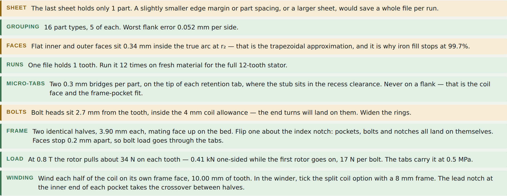

| Tag | Level | Means |
|---|---|---|
| geometry | error | r₁ ≥ r₂, or the tooth is as wide as the slot pitch |
| sheet | error | A part is bigger than the usable sheet |
| grouping | warning / ok | Exact widths finer than the kerf; otherwise the class count and worst flank error |
| flank | warning | Flank error is over two sheet thicknesses |
| faces | warning | The chord shortfall at r₂ is over 0.1 mm (it almost always is; this is a reminder) |
| build | warning | The stack is short of L; the remainder is less than one sheet |
| shoes | warning | Integrated shoes close the slot, or separate plates must go on after winding |
| runs | ok | How many times to run the file |
| kerf | warning | Kerf is zero |
| micro-tabs | warning / ok | A part type is too small for both bridges; otherwise where the bridges went |
| frame | error / warning / ok | No recess left, recess floor under 0.8 mm (error) or 1.2 mm (warning), recesses closer than 1.2 mm, or integrated shoes block the frame |
| bolts | error / warning | Bolt spacing does not divide N; a hole within 1 mm of a pocket or edge; heads inside the coil build allowance; inner ring too narrow |
| notch | warning | The lead notch is shorter than the coil build |
| coil | error | Under 2 mm of tooth left for each coil half |
| load | ok | Pull per tooth, total, per bolt, and tab bearing stress |
| winding | ok | The coil space to enter in the winder |
| block, layout, paths, orientation | ok | EDM: strip count and size, cut layout, how to read the paths, which face goes on the table |
| taper | error / ok | EDM: the wire has to lean past the machine limit |
| stack | warning | EDM: coated sheets conduct poorly through the stack |

---

## 12. Limitations

- **The faces are chords.** Flat sheets stacked radially cannot make an arc face. The shortfall is the sagitta, 0.34 mm on the defaults.
- **The flanks are a staircase.** The class count sets the step size, but a staircase it remains.
- **Square plan-view corners.** The tooth corners the wire wraps round are sheet edges. Use a liner.
- **No bonding step.** The tool cuts the steel and can hold it in a frame. Insulating, bonding or impregnating the stack is up to you.
- **Simple nesting.** Rows of constant height, never rotated. That keeps the rolling direction right and the files predictable, at some cost in material on large fixed sheets.
- **The frame is for prototypes.** Printed plastic creeps under constant load and heat. Re-check bolt preload after the first runs, and move to a bonded or potted stator for anything long-term.
- **The time estimate is a lower bound.** It ignores travel, acceleration and the repeat passes a galvo engraver needs on steel.


---

## 13. Wire EDM

Instead of cutting every sheet separately, you can stack long strips into one block and cut several whole teeth from it at once with a wire EDM.

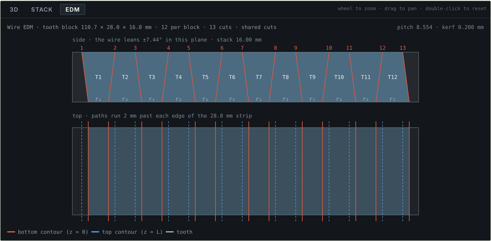

### How it works

- **Strips.** Cut plain strips as wide as the tooth height H and as long as the block. Stack them to the radial length L = r₂ − r₁ (80 strips of 0.2 mm on the defaults) and clamp them. The stack direction is radial, exactly as in a laser-cut tooth.
- **Tilted wire.** The wire runs through the stack, radially, and leans with each flank. Every sheet therefore comes out at its exact width, with no width classes and no staircase on the flanks. Each sheet edge is even bevelled to match.
- **Head-to-tail.** Teeth alternate along the block: T1, T3, T5… have r₁ on the table, T2, T4, T6… have r₂. Neighbouring flanks then lean the same way, so one cut can be the right flank of one tooth and the left flank of the next.
- **Flat faces.** The inner and outer faces are the bottom and top of the stack, so they are flat chords, the same as with the laser.

The flank lean comes from the tooth geometry: `tan θ = (w₂ − w₁) / (2L)`, which is 7.44° on the default stator. Cuts alternate between +θ and −θ.

### Panel 04 in EDM mode

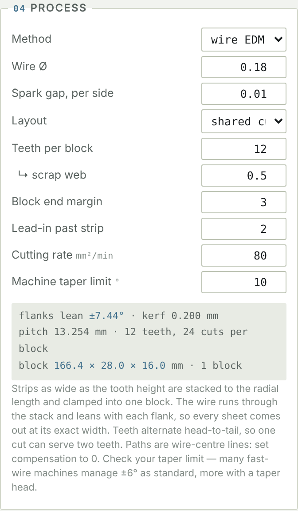

| Field | Default | Meaning |
|---|---|---|
| **Wire Ø** | 0.18 mm | Molybdenum wire on a typical fast-wire machine |
| **Spark gap, per side** | 0.01 mm | The kerf is wire Ø + 2 × gap, 0.20 mm by default |
| **Layout** | shared cuts | *shared*: one cut between neighbouring teeth. *separate*: two cuts per tooth, with scrap between |
| **Teeth per block** | 12 | Teeth cut from one block. The tool works out how many blocks the stator needs |
| ↳ **scrap web** | 0.5 mm | Separate layout only: steel left between two neighbouring cuts |
| **Block end margin** | 3 mm | Stock beyond the first and last cut |
| **Lead-in past strip** | 2 mm | Each cut starts and ends this far outside the strip, so no start holes are needed |
| **Cutting rate** | 80 mm²/min | For the time estimate only. Measure it on your machine with a clamped stack |
| **Machine taper limit** | 10° | The tool fails the job if any cut leans further than this |

Many fast-wire machines manage ±6° as standard and more with a taper head, so check yours. Panel 02's width classes do not apply in EDM mode and are hidden.

### Layouts

| | Shared cuts | Separate cuts |
|---|---|---|
| Cuts per block | N + 1 | 2N |
| Pitch | `(w₁ + w₂)/2 + kerf` | wider by two tab depths, one kerf and the scrap web |
| Defaults (12 teeth) | 8.55 mm pitch, 110.7 mm block, 13 cuts, 91% steel yield, about 73 min | 13.25 mm pitch, 166.4 mm block, 24 cuts, 60% yield, about 154 min |
| Retention tabs | Not possible | Yes |
| Integrated pole shoes | Not possible | Yes |

Shared cuts need straight flanks. Retention tabs and integrated pole shoes stick out into the neighbouring tooth, so with either of them on, the tool switches to separate cuts and says so in the notes.

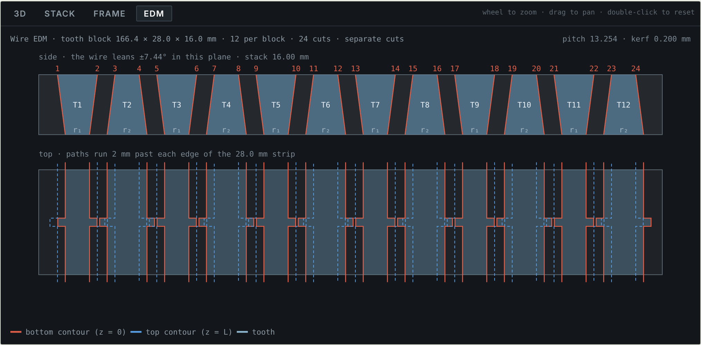

**Pole shoes:**

- **Integrated I-shapes** are cut in one go. The flange tips lean more than the body flanks (11.7° at a 0.8 face ratio), and the bottom and top contours carry both angles.
- **Separate shoe plates** get a second block of their own: strips as wide as the shoe thickness, two plates per tooth. Toggle between the two blocks with the button in the view bar.

### Preparing the block

1. Cut `n = floor(L / t)` strips per block, of the size in the readouts (110.7 × 28 mm on the defaults). Deburr them and keep them flat.
2. Stack them and clamp hard between two steel plates. Coated electrical steel conducts poorly from sheet to sheet, so put the wire's electrical contact on solid steel and expect a slower cut than on solid stock.
3. Measure the clamped stack height. The program assumes it is L. If it differs, scale the top contour's height in your CAM.
4. Put the block on the table with z = 0 down. That face is r₁ for T1, T3, T5…

### EDM files

| File | Contents |
|---|---|
| `edm_body_drawing.svg` | The operator's drawing: side view with the lean, top view with both contours, dimensions, and the cut table |
| `edm_body_cuts.csv` | One row per cut: type, direction, taper, flank x at the bottom and top, path length, the teeth it separates |
| `edm_body_top_bottom.dxf` | Both contours in one file. Layer `WIRE_BOTTOM_Z0` is the table side; layer `WIRE_TOP_Z16_00` is lifted to its true height, so a 3-D viewer shows the taper. Also has stock and tooth outlines |
| `edm_body_bottom.dxf`, `edm_body_top.dxf` | One contour each, flat at z = 0, for CAM software (HF, AutoCut and similar) that loads the lower and upper shapes as two files for taper cutting |

For separate shoe plates the same five files appear again with `edm_shoe_`. **All · zip** saves everything.

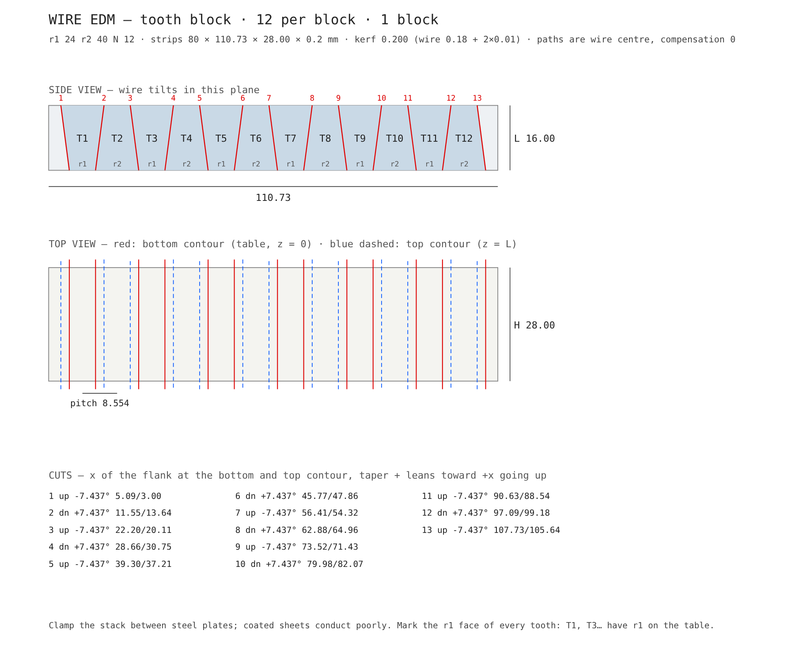

How to read the paths:

- **Wire centre.** Every path is the wire centre, already offset by half the kerf, so set wire compensation to 0.
- **Matching contours.** Each cut is an open polyline, and its bottom and top versions have the same number of vertices in the same order, so the CAM can pair them segment by segment.
- **Serpentine order.** Cuts alternate up and down across the strip, so the wire never travels back empty.

### After cutting

- **Mark each tooth before it comes out.** Teeth leave the block as finished stacks, half of them upside down. Mark the r₁ face of each one first.
- **Keep each tooth's sheets together.** They match only their own neighbours.
- Deburr the flanks lightly. Then bond the tooth, or seat it in the retention frame.

### Limits

- **Flat faces.** The faces are still chords, so the sagitta is unchanged at 0.34 mm on the defaults.
- **Clamping matters.** The stack must not shift during the cut, and the coating's poor conductivity is the main practical risk.
- **The time estimate is rough.** It is the cut area divided by your rate, ignoring threading, travel and skim passes.

---

[← README](../README.md) · [Axial Coil Winder](../../README.md) · MIT · [Ozan Keysan](http://keysan.me)
